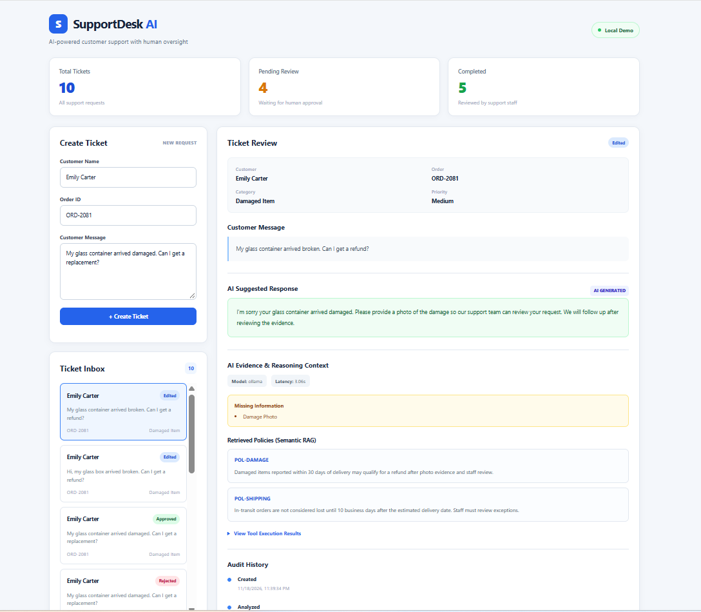
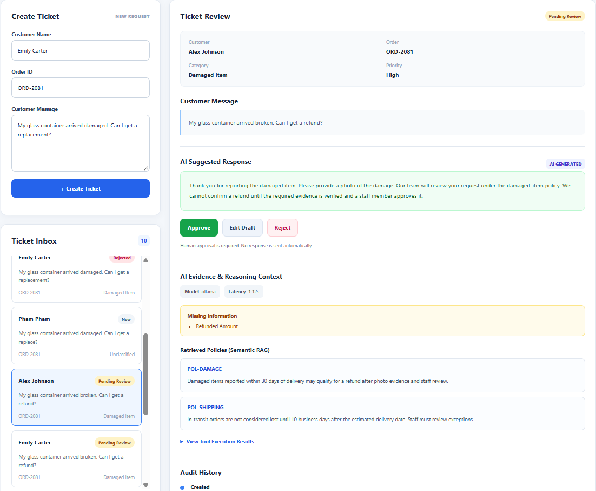
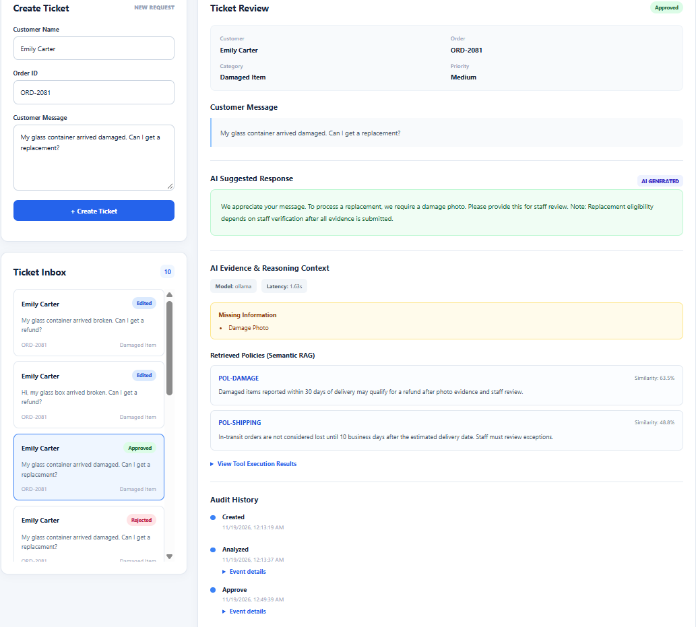

# SupportDesk AI

A customer support application that uses AI to classify tickets, retrieve relevant policies, and draft responses for human review.

Built to explore how LLMs can work with backend systems while keeping people in control of important decisions.

## Screenshots

### Dashboard


### AI Review


### Audit History


## Tech Stack

- **Backend:** Python, FastAPI, PostgreSQL, pgvector
- **AI:** Ollama (Qwen3 4B), RAG, embeddings
- **Frontend:** React, TypeScript, Vite
- **Testing & Tools:** pytest, Docker Compose

## Features

- Create and manage customer support tickets
- Classify tickets and assign priorities
- Retrieve support policies using semantic search
- Generate AI-assisted responses with safety checks
- Approve, edit, or reject responses before sending
- Track ticket activity through audit logs

## Getting Started

Requires Docker Desktop and Ollama with `qwen3:4b` and `nomic-embed-text` installed.

```powershell
ollama pull qwen3:4b
ollama pull nomic-embed-text

Copy-Item .env.example .env
docker compose up --build
```

Open:
- Frontend: http://localhost:5173
- API documentation: http://localhost:8000/docs

Seed the support policies before testing semantic search:

```powershell
docker compose exec api python -m app.seed_policies
```

Create a ticket using the sample order `ORD-2081`, run AI analysis, and review the suggested response.

## Tests

```powershell
docker compose exec api python -m pytest -q
```

14 automated tests currently pass.

## Notes

This is a local portfolio project using synthetic customer and order data. AI-generated responses require human review. No actual refunds or customer messages are sent.

The project is not production-ready and does not include user authentication or production deployment.